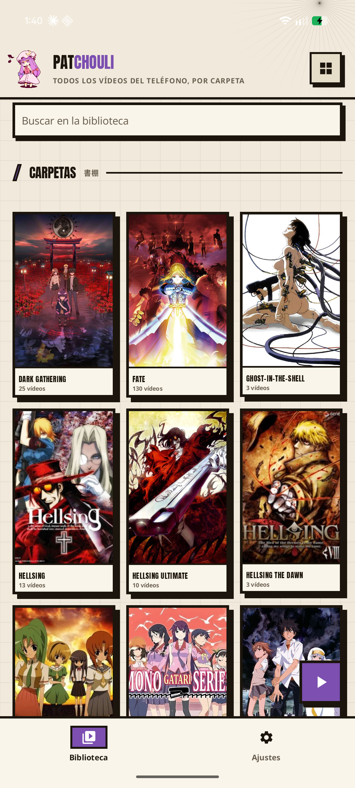
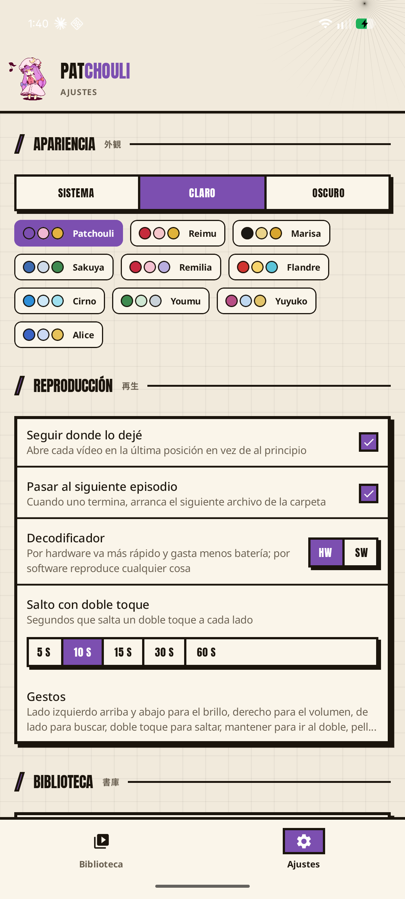
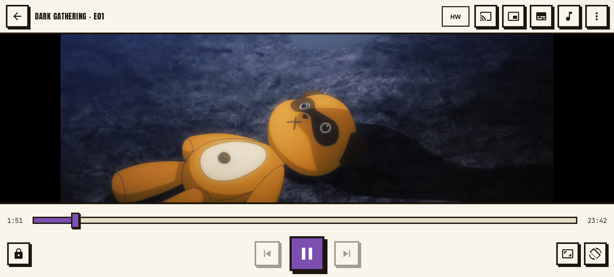

[English](README.md) · [Español](README.es.md)

<p align="center"></p>

<h1 align="center">Patchouli <sub>パチュリー</sub></h1>

<p align="center">A video player for the anime you already have on your phone.<br>Your folders become the library, the gestures are the ones you know.</p>

<p align="center">
<a href="https://github.com/Chidaruma696/Patchouli/releases/latest"></a>
</p>

<p align="center">


</p>

<p align="center">
 &nbsp; 
</p>
<p align="center"></p>

<br/>

## 📖 What it is

MX Player used to be the player for everybody with a folder of episodes; then the ads moved in. Patchouli is that player, made from scratch, for one job: play the files on your phone and keep track of where you are in each series.

| The library | The player | The engine |
| --- | --- | --- |
| Every video on the phone, grouped by folder, as a list or a grid. A folder with episodes gets its cover, year, synopsis and episode names from the catalogues; a folder with seasons becomes a shelf. A floating play resumes the last video. Watched marks by hand, hide the watched, sort, delete what is seen. | Brightness on the left, volume on the right, drag sideways to seek with a frame preview, double tap to skip, hold for 2×, pinch to zoom. Skip the opening and the ending. Tracks remembered per series, delays, sleep timer, extra volume, chapters, snapshots, a TV over DLNA. | libVLC: hardware decoding with a software fallback, so the MKV that nothing else opens plays here. Headphone and Bluetooth buttons, audio focus, refresh-rate matching, audio levelling. |

A folder laid out as `Franchise/01 - Series/Series - E01.mp4` reads as a tree (the franchise, then its series in order, then the episodes), but any folder of videos works the same.

<br/>

## 📲 Download

Grab the APK from the [latest release](https://github.com/Chidaruma696/Patchouli/releases/latest) and install it. Android 8.0 or newer. The app asks for permission to read your videos and nothing else. What leaves the phone: the name of a folder, to find its cover (AniList, else Jikan, else Kitsu); a series id and an episode number, for the episode names (Jikan) and for where the opening and ending are (AniSkip); all of that goes away with one switch in Settings. Your AniList list is written only if you connect an account, and only with the episodes you finish.

<br/>

## 🖐 Gestures

| Gesture | What it does |
| --- | --- |
| Tap | Show or hide the controls |
| Double tap on the left / right | Skip back / forward (10 s by default, up to 60) |
| Double tap in the middle | Play / pause |
| Drag up or down on the left half | Brightness |
| Drag up or down on the right half | Volume |
| Drag sideways | Seek, with the target time shown while you drag |
| Hold | Play at 2× until you let go |
| Pinch | Zoom |

<br/>

## 🎨 Look

The interface is drawn like a manga page: cream paper with grid lines, square panels with a 3 dp line of ink and a hard shadow that sinks when pressed, tone sheets of dots in the corners, Anton capitals for the headlines, stamps for buttons. The drawing comes from the design system of [Komi Store](https://github.com/kurikomi-labs/komi-store) (Apache 2.0), carried over into Patchouli's kit. Day paper and night paper; ten palettes named after Touhou Project characters lend the accent colour, Patchouli's by default.

<br/>

## 🔧 How it works

- **Library.** One query to the MediaStore gives every video with its path and duration; the app builds a tree of folders from the paths. Chains of folders with a single child collapse (`Movies/Anime` reads as "Anime"). Episode numbers come from the file names (`E01`, `- 03`, `03 Title`, `Title 03 [1080p]`).
- **Covers.** Each folder name, cleaned of its `01 - ` prefix and underscores, is searched once on AniList (no key needed). The answer is cached on disk; common folder names (Camera, Download…) are never looked up, and any folder can be marked "not a series".
- **Progress.** Position and length of every file watched, in SharedPreferences. A file is "watched" past 95 %; below that the floating play button resumes it where it was left. Everything remembered can be backed up to a JSON file and restored on another phone.
- **Openings and endings.** AniSkip is asked once per episode, by MyAnimeList id and episode number, and answers for the cut of the episode whose length matches the file; the file's own chapters named "OP" or "ED" stand in when it has nothing.
- **Player.** `PlayerActivity` holds libVLC; `PlayerScreen` is Compose over a `VLCVideoLayout`. All gestures live in one pointer-input detector so they never fight each other.

<br/>

## 🛠 Build

```
git clone https://github.com/Chidaruma696/Patchouli
cd Patchouli
./gradlew :app:assembleDebug
```

JDK 17+, Android SDK 36. Release signing reads `keystore.*` from `local.properties` (never committed) and falls back to the debug key.

<br/>

## 🗺 Roadmap

- [x] Library from the MediaStore, folder tree, franchise layout
- [x] Covers and synopses from AniList, with a cache and a "not a series" switch
- [x] Continue watching, resume, next episode
- [x] Gestures: brightness, volume, seek, double tap, hold for 2×, pinch
- [x] Lock, aspect ratio, subtitle and audio tracks, speed, HW/SW decoder, rotation
- [x] Picture in picture: leave the player and it keeps playing in a floating window
- [x] External subtitles: `.srt`/`.ass`/`.vtt` next to the file are picked up, or load one from anywhere
- [x] Search inside the library
- [x] Send to a TV over DLNA: the phone serves the file, the TV plays it where you were, the phone becomes the remote with a seek bar
- [x] Library as a list or a grid of 2, 3 or 4, inside folders too; a floating play that resumes the last video
- [x] Sort a folder: number the seasons, name the episodes, with a preview
- [x] The manga look, after Komi Store
- [x] Read an AniList id left in the folder (`anilist.json`, with `anilist` and/or `mal`) instead of searching by name
- [x] Episode names, watched marks by hand, sort and hide the watched, tracks remembered per series, next-episode card
- [x] Skip openings and endings: AniSkip, or the file's chapters
- [x] Sleep timer, subtitle and audio delay, subtitle size and style, extra volume, chapters, snapshots, frame preview while seeking
- [x] Headphone and Bluetooth buttons, audio focus, refresh-rate matching, audio levelling
- [x] Backup and restore, delete watched episodes, a "play on" shortcut on the icon
- [x] AniList progress sync (needs the app's client id to be registered)
- [ ] A NAS as a source: browse an SMB share and play from it, the shelves and the bookmarks the same as on the phone
- [ ] Chromecast (Google's Cast SDK; kept out so far to stay free of Play services)

<br/>

## ⚖️ Legal

Apache License 2.0; see [LICENSE](LICENSE). Third-party components and their licenses are listed in [THIRD_PARTY_NOTICES.md](THIRD_PARTY_NOTICES.md). libVLC is used as an unmodified dynamic library under the LGPL 2.1.

The chibi Patchouli above and in the app is ["Chibi Patchouli Knownledge (Touhou)"](https://www.deviantart.com/fantastiic/art/Chibi-Patchouli-Knownledge-Touhou-305044472) by **Fantastiic**, [CC BY-NC 3.0](https://creativecommons.org/licenses/by-nc/3.0/), with the artist's watermark cropped out. It is not covered by the Apache license: credit the artist and keep it out of anything commercial.

Patchouli plays files that are already on your device. It does not download, stream or share anything.

Touhou Project and its characters belong to Team Shanghai Alice (ZUN); unofficial fan work made under their guidelines for derivative works, with no affiliation or endorsement.

<br/>

## 📢 Keep Android Open

Google has announced that from 2027 every Android developer will have to register and verify their identity before an app can be installed on a certified device, Play Store or not. Patchouli is made by one person and will not exist under that rule. Read what is going on at [keepandroidopen.org](https://keepandroidopen.org/).

<br/>

<p align="center">パチュリー</p>
